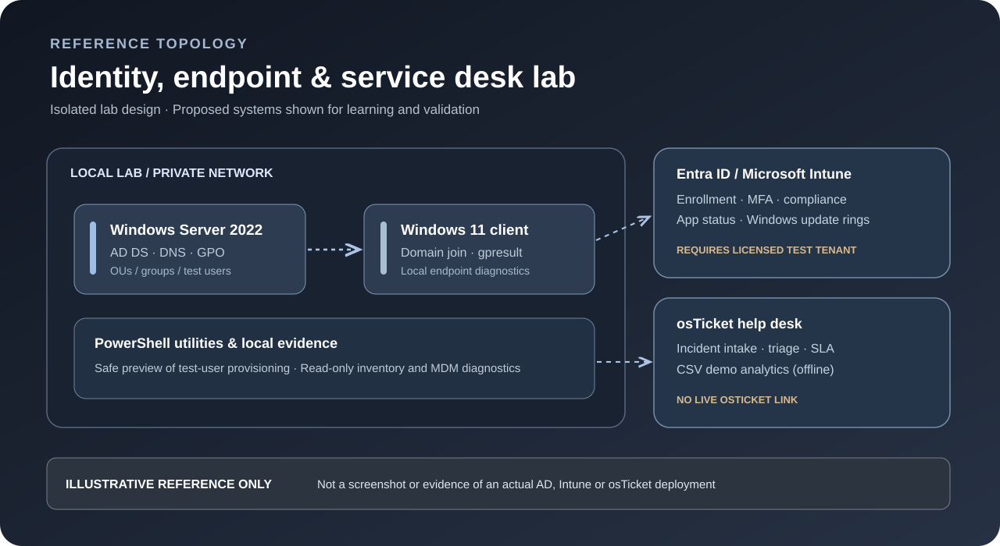
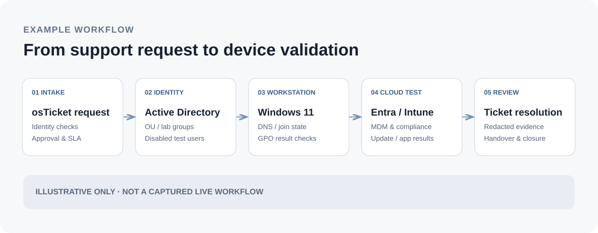
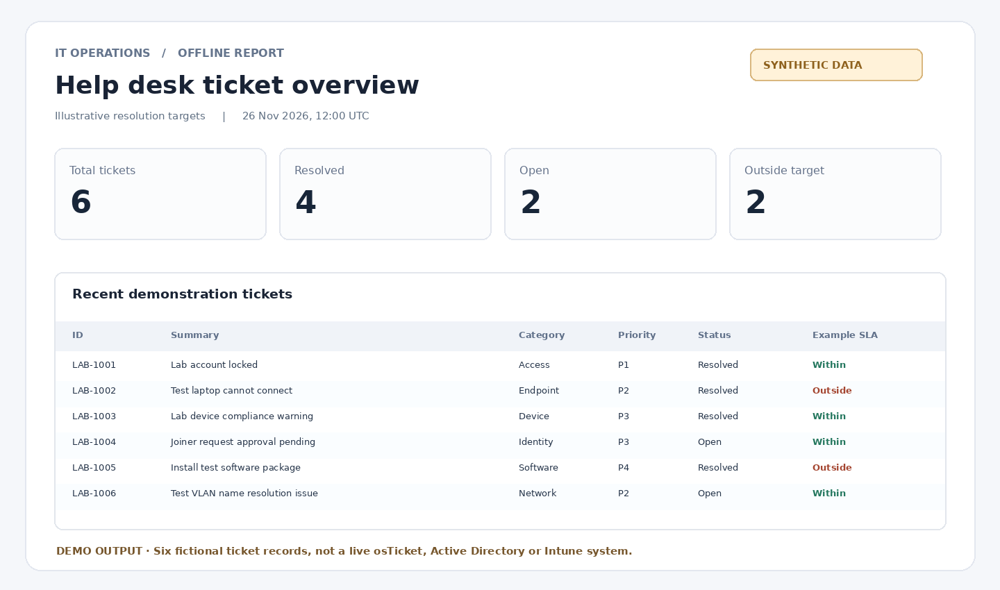
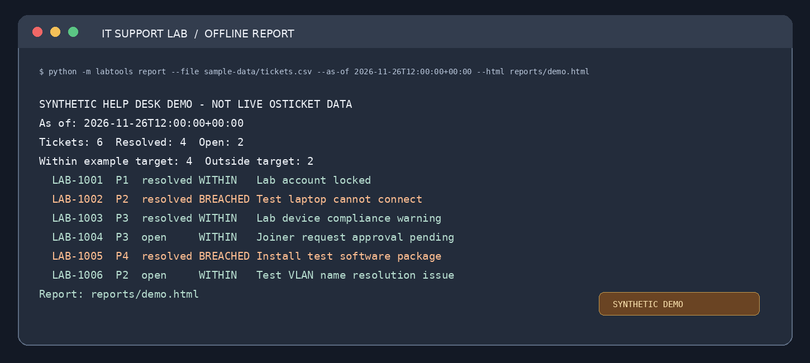

# Windows Server · Active Directory · Intune · Help Desk Lab

**Identity, endpoint-management and IT service-desk workflows in a controlled lab.**  
Windows Server 2022 (reference build) · Active Directory Domain Services · Group Policy · Microsoft Entra ID · Microsoft Intune · osTicket · PowerShell · Python

**[View verified evidence, demo outputs and GitHub CI results](validation/VERIFIED-EVIDENCE.md)** · [Read the historical lab evidence capture plan](validation/PROVE-YOUR-LAB.md)



> **Evidence and implementation status**  
> This repository publishes **runnable offline ticket analytics**, **guarded PowerShell lab templates**, reproducible configuration procedures, and **illustrative diagrams/demo screenshots**. It does **not** establish that a Windows Server 2022 forest, Entra/Intune tenant, or osTicket instance has been deployed. Original live-system screenshots, GPO backup exports, tenant policies and osTicket tickets were not available for this publication. Do **not** interpret the diagrams or the synthetic report screenshot as proof of live deployment.

## At a glance

| Area | Included in this repository | Validation status |
|---|---|---|
| Windows Server 2022 / AD DS | Setup checklist, OU/group design, cautious bulk-user provisioning script, read-only AD inventory | Templates and procedure; real forest not independently verified |
| Group Policy | Suggested test GPO baseline and RSoP / GPO report runbook | Manual deployment/validation required |
| Entra ID / Intune | Enrollment, MFA, device compliance, update ring and app-management checklists; read-only endpoint diagnostics | No tenant or enrolled devices connected |
| osTicket | Workflow and SLA/runbook examples, synthetic ticket CSV, Python report generator | CSV-based offline demo, **not** an osTicket API integration |
| Evidence | Architecture SVG, workflow SVG, synthetic report visualization, demo CLI visualization, evidence checklist | Sample screenshots explicitly labelled as demos |
| Quality assurance | Python standard-library unit tests and CI workflow | Can run without Windows, domain admin, tenant or secrets |

## Visuals

**Architecture (illustrative, not a deployment screenshot)**


**Enrollment and ticket lifecycle (illustrative)**



**Offline ticket report (rendered sample view of the included analysis tool, using fictional data)**



**Command-line demo (illustrated rendering of output from running the included program with fictional data)**



## Project layout

```text
assets/                     Architecture diagrams and labelled demo screenshots
configs/                    Example users, group definitions, GPO policy checklist
scripts/                    Safe-by-default PowerShell templates and read-only diagnostics
labtools/                   Offline Python SLA and ticket analysis
sample-data/                Six fictional help desk incidents
reports/                    Generated, synthetic HTML demo report
runbooks/                   Practical lab setup and troubleshooting guides
validation/                 Evidence capture and verification instructions
tests/                      Local automated tests
.github/workflows/          GitHub Actions unit-test workflow
```

## Try the executable offline component

Python 3.10+ (no external Python dependencies):

```bash
python -m unittest discover -s tests -v
python -m labtools report --file sample-data/tickets.csv --as-of 2026-11-26T12:00:00+00:00
python -m labtools report --file sample-data/tickets.csv --as-of 2026-11-26T12:00:00+00:00 --html reports/demo.html
```

The `--as-of` argument makes synthetic SLA calculations reproducible. Targets use **elapsed clock hours**, not business hours and not any employer's actual SLA contract. Real SLA calculations need the service calendar, holidays, priority matrix and pause conditions.

## Safely trial the PowerShell templates

```powershell
# Preview only, no AD account changes:
.\scripts\Invoke-LabUserProvisioning.ps1 -CsvPath .\configs\sample-users.csv

# Read-only local Entra/MDM diagnostic capture; output is local only:
.\scripts\Get-EndpointEnrollmentEvidence.ps1 -OutputDirectory .\evidence-local

# Read-only AD inventory in a connected, authorised lab domain:
.\scripts\Get-LabADInventory.ps1 -OutputDirectory .\evidence-local
```

AD provisioning is deliberately **non-operative by default**. `-Apply` is required to request changes and `ShouldProcess` supports `-WhatIf`/confirmation. The script refuses domains other than the designated `corp.lab.example` lab domain. A correctly configured and authorised AD environment is required before any apply attempt. Review scripts and back up a test VM before making changes.

## How to document a completed lab honestly

**Author-confirmed lab, awaiting externally inspectable evidence:** The project owner has confirmed completing the Windows Server, AD DS, GPO, Entra/Intune and osTicket tasks. The current public files demonstrate the reproducible offline tooling, but the original deployment screenshots and configuration exports are not yet present.

**[Open the step-by-step evidence capture guide](validation/PROVE-YOUR-LAB.md)**. It maps every CV claim to a real screenshot or read-only export, explains safe redaction, and provides an integrity-inventory helper at [`scripts/New-LabEvidenceManifest.ps1`](scripts/New-LabEvidenceManifest.ps1).

See also [`validation/EVIDENCE-CHECKLIST.md`](validation/EVIDENCE-CHECKLIST.md). Save **redacted real screenshots** under `assets/evidence/` only after verifying they genuinely show your own lab. Suggested captures: ADUC OUs and groups, `Get-ADDomain` and server version, `gpresult` summary, `dsregcmd /status` with tenant/user IDs removed, Intune device compliance and update-ring status, osTicket queues/SLA dashboard with names and email addresses removed.

Until that is done, this repo is best described on a CV as a **documented Windows/AD/Intune/osTicket lab reference with offline ticket reporting and automation templates**, not as verified proof of completing every infrastructure deployment.

## Authoritative configuration references

- [Microsoft Learn: Install Active Directory Domain Services](https://learn.microsoft.com/en-us/windows-server/identity/ad-ds/deploy/install-active-directory-domain-services--level-100-)
- [Microsoft Learn: `Install-ADDSForest`](https://learn.microsoft.com/en-us/powershell/module/addsdeployment/install-addsforest?view=windowsserver2022-ps)
- [Microsoft Learn: Windows enrollment for Microsoft Intune](https://learn.microsoft.com/en-us/intune/device-enrollment/windows/guide)
- [Microsoft Learn: `dsregcmd` device troubleshooting](https://learn.microsoft.com/en-us/entra/identity/devices/troubleshoot-device-dsregcmd)
- [Microsoft Learn: Intune update rings](https://learn.microsoft.com/en-us/intune/device-updates/windows/manage-update-rings)
- [osTicket: ticket API documentation](https://docs.osticket.com/en/latest/Developer%20Documentation/API/Tickets.html) (create-only; not a general-purpose ticket export API)

**Safety:** Use test accounts, fictional tickets and isolated VMs. Never publish credentials, real ticket content, identifiable users, tenant IDs, public IPs or private hostnames.
