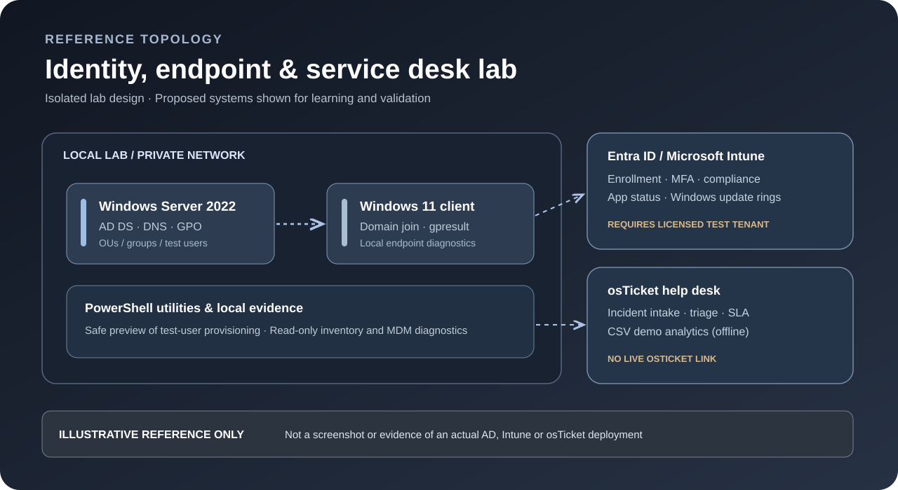
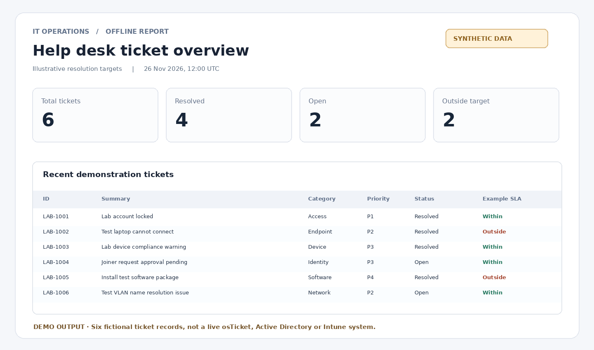
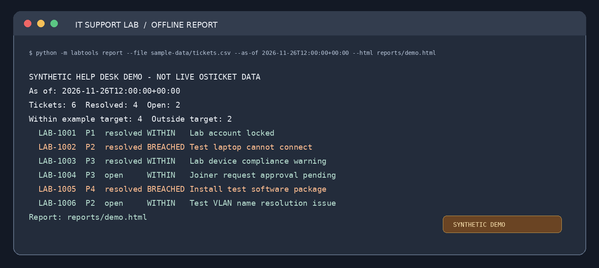

# Verification and demonstration evidence

This page is an **evidence index**, not a claim that archived infrastructure screenshots were recovered.

**Historical work:** The project owner confirms having completed Windows Server, Active Directory, Group Policy, Entra/Intune and osTicket lab tasks. Original screenshots, VM exports, Intune policy exports and osTicket database/ticket exports are no longer available. Those historical tasks are therefore **self-reported**, not independently verified by this repository.

**What is independently inspectable here:** Source code, configuration examples, 12 offline Python tests, a reproducible Python CLI/HTML report, an AD provisioning script with a preview-only path, the scripts' PowerShell parser checks, and GitHub-hosted CI runs. Test results substantiate these **current artifacts only**. They do not substantiate a live Microsoft tenant, deployed Windows Server domain or osTicket installation.

## Verified, reproducible evidence

| Capability | Source or visible demonstration | Verification | What it does **not** prove |
|---|---|---|---|
| Offline incident triage and illustrative SLA calculations | [Python analyzer](../labtools/tickets.py), [six fictional tickets](../sample-data/tickets.csv), [synthetic dashboard](../assets/screenshots/synthetic-ticket-dashboard.png) | [12 unit tests](../tests/test_tickets.py), [automated test workflow](../.github/workflows/validate.yml) | An osTicket server, real service-desk tickets or business-hours SLA accuracy |
| Rendered report and CSV validation | [CLI](../labtools/__main__.py), [example HTML report](../reports/demo.html), [CLI demo image](../assets/screenshots/synthetic-ticket-cli.png) | Run `python -m labtools report --file sample-data/tickets.csv --as-of 2026-11-26T12:00:00+00:00`; GitHub Actions saves the actual output | Live osTicket integration |
| Safe Active Directory account script | [PowerShell script](../scripts/Invoke-LabUserProvisioning.ps1), [fictional user records](../configs/sample-users.csv) | Windows GitHub Actions runner checks syntax and runs **non-operative preview only**, saving its actual CLI output | An AD domain was joined, any real AD accounts were created, or a bulk import ran in a domain |
| Windows AD inventory and Entra device diagnostics | [AD inventory](../scripts/Get-LabADInventory.ps1), [device status collection](../scripts/Get-EndpointEnrollmentEvidence.ps1) | PowerShell syntax parse in CI; commands are designed for authorised local execution | Actual AD / Entra / Intune environment integration |
| Planned Group Policy exercises | [Example GPO baseline](../configs/example-gpo-baseline.md), [AD runbook](../runbooks/01-windows-ad-build.md) | Documentation can be reviewed | GPOs are configured, linked or applied to a real client |
| Intune enrolment, compliance, app deployment and update rings | [Entra/Intune runbook](../runbooks/02-intune-entra.md) | Documented validation procedure | Live enrolment, policy enforcement, app installation or update compliance |
| Help desk procedures | [osTicket runbook](../runbooks/03-osticket-helpdesk.md), [workflow drawing](../assets/workflow.svg) | Documented scenarios; synthetic analyzer tests | Live osTicket SLAs or resolved cases in osTicket |

## Download independent build output

Open the latest successful run of [Validate offline lab demos](https://github.com/SamXl-Codes/Windows-Server-AD-Intune-Helpdesk-Lab/actions/workflows/validate.yml) on GitHub. Under **Artifacts** download:

- **offline-ticket-analysis-evidence**: actual Python unit-test console output, a CLI transcript generated from fictional sample tickets, and the generated HTML report.
- **powershell-dry-run-evidence**: the output of executing the account provisioning script in **preview-only** mode on a Windows GitHub Actions runner. This makes **no Active Directory changes**.

These are generated on GitHub-hosted computers from the public source each time the workflow runs. They are *not screenshots of a completed Windows Server/Intune/osTicket installation*. Artifacts are temporary (30-day retention) and the runs require successful GitHub Actions execution to be available.

### Verify the work yourself

```bash
python -m unittest discover -s tests -v
python -m labtools report --file sample-data/tickets.csv --as-of 2026-11-26T12:00:00+00:00 --html reports/demo.html
```

On Windows/PowerShell, to check the AD provisioning **preview without any domain connection**:

```powershell
.\scripts\Invoke-LabUserProvisioning.ps1 -CsvPath .\configs\sample-users.csv
```

Expected: `PREVIEW ONLY` and `No directory changes were attempted`.

## Visual gallery

### Architecture sketch (illustrative)



### Ticket analysis screenshot (synthetic)



### PowerShell/command-line example visual (synthetic)



**Provenance:** The gallery contains generated concept diagrams and synthetic views. These visualizations are helpful to understand the project, but are **not authentic captures of the original lab environment**.

## What remains unverified

1. Actual Windows Server **2022** operating-system build and AD DS domain creation.
2. Live OU and group objects, completed bulk user provisioning, and actual GPO application on a joined client.
3. Intune-registered/enrolled Windows devices, MFA enforcement, compliance outcomes, installed apps and successful update-ring check-ins.
4. osTicket installation and completed real test-ticket/SLA exercises.

The owner confirmed having performed these historical tasks. Without original captures/exports or renewed access to a test environment, no third party can directly validate them from this repository.

If a new lab is rebuilt, add genuine, clearly dated and carefully redacted evidence following [the capture plan](PROVE-YOUR-LAB.md). Label **newly recreated lab validation** as such, not as original historical evidence. Protect all secrets, tenant IDs and user information. No recreated screenshot should be presented as if it were a past deployment.

**What to tell recruiters:** This repository provides current verifiable examples of ticket-analysis automation, PowerShell script design, documented Windows/identity/endpoint management processes and CI-tested offline components. The broader Windows Server/Intune/osTicket practical experience is reported by the project owner and can be discussed or demonstrated again, but original deployment artifacts are not presently published.
